:::info Generated
Generated from `schema/tma.yaml` at build time by `gen-markdown-datadict`. Do not edit; change the schema.
:::

## Units

| Class | Slot | Unit (UCUM) |
| --- | --- | --- |
| CurvePoint | t_since_zig_s | `s` |
| NaiveMeans | speed_mps | `m/s` |
| Observation | bearing_rad | `rad` |
| Observation | timestamp_s | `s` |
| PlatformState | course_rad | `rad` |
| PlatformState | speed_mps | `m/s` |
| PlatformState | timestamp_s | `s` |
| PlatformState | x_m | `m` |
| PlatformState | y_m | `m` |
| PredictionRow | course_rad | `rad` |
| PredictionRow | range_m | `m` |
| PredictionRow | speed_mps | `m/s` |
| PredictionRow | timestamp_s | `s` |
| PredictionRow | x_m | `m` |
| PredictionRow | y_m | `m` |
| ScenarioMetadata | mean_range_m | `m` |
| ScenarioMetadata | min_range_m | `m` |
| ScenarioMetadata | zig_time_s | `s` |
| ScenarioParameters | dt_s | `s` |
| ScenarioParameters | noise_sigma_rad | `rad` |
| ScenarioParameters | ownship_course0_rad | `rad` |
| ScenarioParameters | ownship_speed_mps | `m/s` |
| ScenarioParameters | target_bearing0_rad | `rad` |
| ScenarioParameters | target_course_rad | `rad` |
| ScenarioParameters | target_range0_m | `m` |
| ScenarioParameters | target_speed_mps | `m/s` |
| ScenarioParameters | window_s | `s` |
| ScenarioParameters | zig_angle_rad | `rad` |


**metamodel version:** 1.12.0

**version:** 0.2.0


Single source of truth for every data type in the TMA via ML proof of concept (constitution principle I). Frame: local flat-earth Cartesian, x east, y north, metres, origin at ownship's window-start position. Bearings and courses are true, clockwise from north, radians in [0, 2π). Speeds in m/s. Times in seconds since window start. All stored floats are float32-rounded.


## ERD Diagrams


### Component 1 (DatasetHeader, DatasetRef, EstimatorRef...)

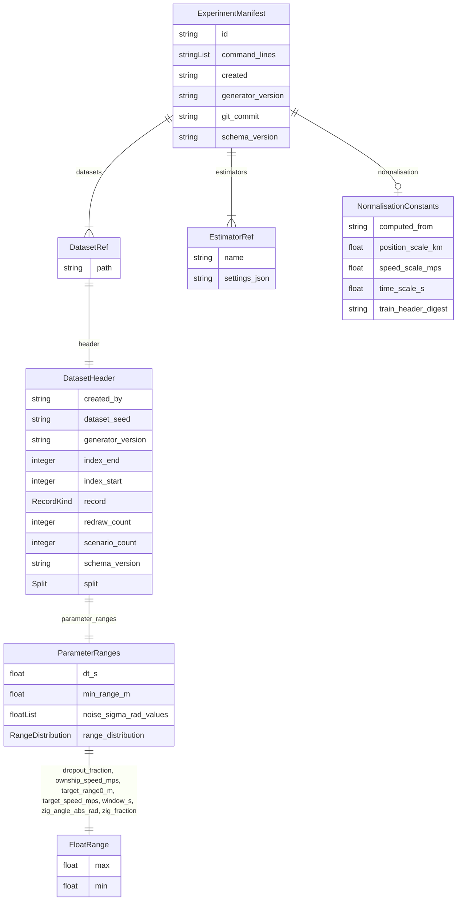

### Component 2 (GateCheck, GateVerdict)

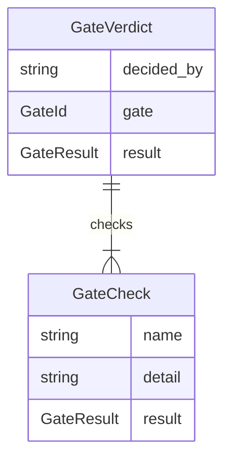

### Component 3 (NaiveMeans, NaiveModel)

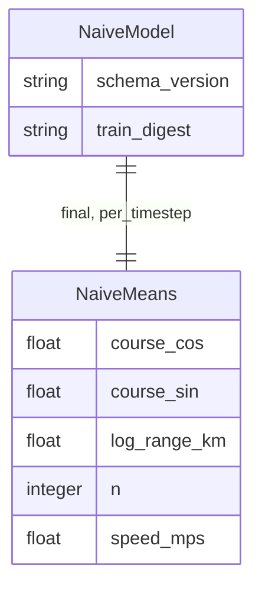

### Component 4 (Observation, PlatformState, Scenario...)

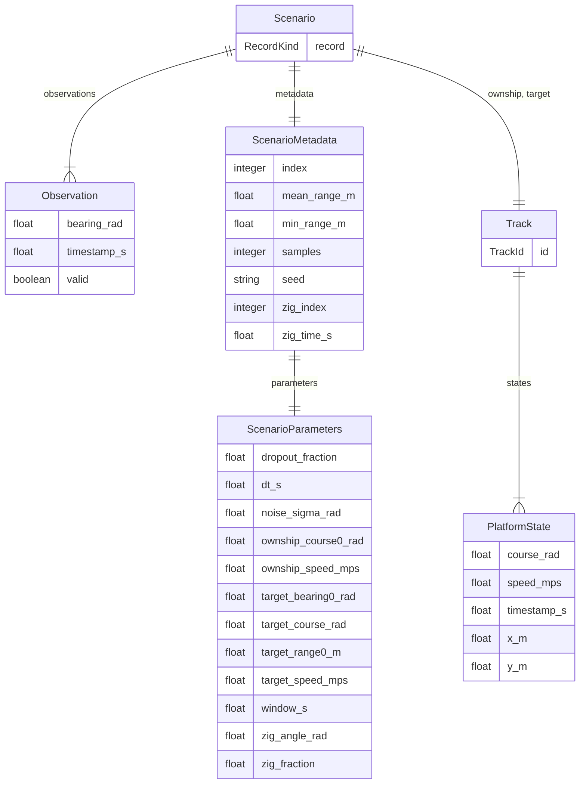

### Component 5 (Prediction, PredictionRow)

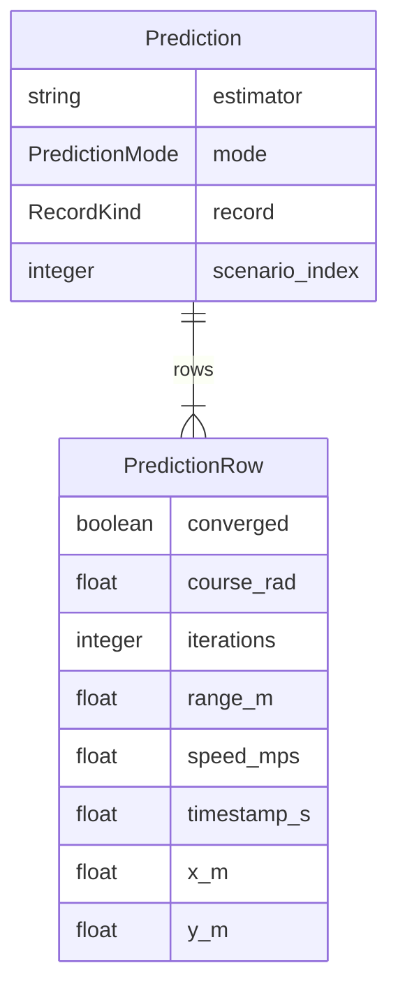

## Standalone Classes


These classes are completely isolated with no relationships and are not used as base classes:

| Class | Description |
| --- | --- |
| [CurvePoint](#curvepoint) | One point of an error-vs-time-since-zig curve (curves.csv row). |
| [FeatureLayout](#featurelayout) | Documents the model tensors (not stored as records). inputs [N, 240, 10]: bearing_sin, bearing_cos, own_x_km, own_y_km, own_course_sin, own_course_cos, own_speed_scaled, time_scaled, valid, window_mask. targets [N, 240, 6]: log_range_km, course_sin, course_cos, speed_scaled, x_km, y_km. loss_mask [N, 240]: window_mask and t ≥ zig_time. |
| [MetricsRecord](#metricsrecord) | Metric values for one estimator on one slice at one evaluation point. |
| [PredictionHeader](#predictionheader) | First record of every prediction file. |

## Classes


### CurvePoint

One point of an error-vs-time-since-zig curve (curves.csv row).


#### Attributes

| Name | Cardinality: | Type | Description |
| --- | --- | --- | --- |
| **[course_deg_median](#curvepoint__course_deg_median)** | <sub>1..1</sub> | float |  |
| **[estimator](#curvepoint__estimator)** | <sub>1..1</sub> | string |  |
| **[gross_error_rate](#curvepoint__gross_error_rate)** | <sub>1..1</sub> | float |  |
| **[n](#curvepoint__n)** | <sub>1..1</sub> | integer |  |
| **[range_rel_median](#curvepoint__range_rel_median)** | <sub>1..1</sub> | float |  |
| **[range_rel_p90](#curvepoint__range_rel_p90)** | <sub>1..1</sub> | float |  |
| **[speed_kt_median](#curvepoint__speed_kt_median)** | <sub>1..1</sub> | float |  |
| **[t_since_zig_s](#curvepoint__t_since_zig_s)** | <sub>1..1</sub> | float |  |


### DatasetHeader

First record of every dataset file.

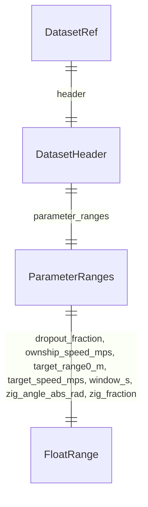

#### Attributes

| Name | Cardinality: | Type | Description |
| --- | --- | --- | --- |
| **[created_by](#datasetheader__created_by)** | <sub>1..1</sub> | string | Command line that produced the file. |
| **[dataset_seed](#datasetheader__dataset_seed)** | <sub>1..1</sub> | string | Decimal uint64 string. |
| **[generator_version](#datasetheader__generator_version)** | <sub>1..1</sub> | string |  |
| **[index_end](#datasetheader__index_end)** | <sub>1..1</sub> | integer | Last scenario index (exclusive). |
| **[index_start](#datasetheader__index_start)** | <sub>1..1</sub> | integer | First scenario index (inclusive). |
| **[parameter_ranges](#datasetheader__parameter_ranges)** | <sub>1..1</sub> | [ParameterRanges](#parameterranges) |  |
| **[record](#datasetheader__record)** | <sub>1..1</sub> | [RecordKind](#recordkind) |  |
| **[redraw_count](#datasetheader__redraw_count)** | <sub>1..1</sub> | integer | Geometries rejected for violating min_range_m. |
| **[scenario_count](#datasetheader__scenario_count)** | <sub>1..1</sub> | integer |  |
| **[schema_version](#datasetheader__schema_version)** | <sub>1..1</sub> | string |  |
| **[split](#datasetheader__split)** | <sub>1..1</sub> | [Split](#datasetheader__split) |  |

#### Referenced by:

 *  **[DatasetRef](#datasetref)** : datasetRef__header  <sub>1..1</sub> 


### DatasetRef


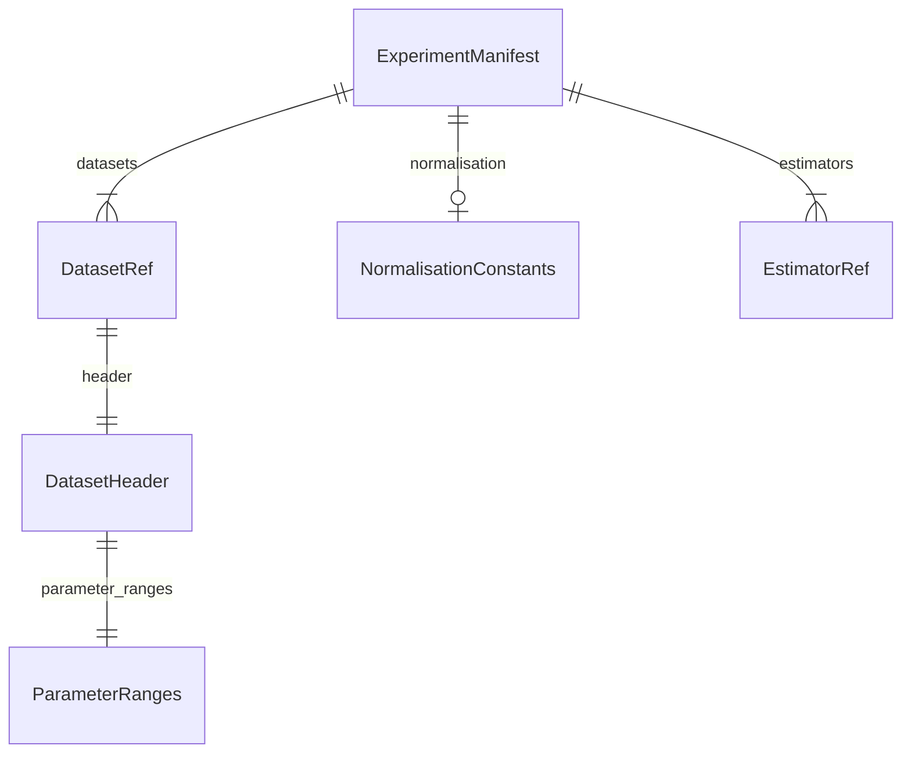

#### Attributes

| Name | Cardinality: | Type | Description |
| --- | --- | --- | --- |
| **[header](#datasetref__header)** | <sub>1..1</sub> | [DatasetHeader](#datasetheader) |  |
| **[path](#datasetref__path)** | <sub>1..1</sub> | string |  |

#### Referenced by:

 *  **[ExperimentManifest](#experimentmanifest)** : experimentManifest__datasets  <sub>1..\*</sub> 


### EstimatorRef


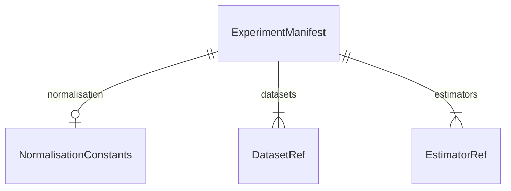

#### Attributes

| Name | Cardinality: | Type | Description |
| --- | --- | --- | --- |
| **[name](#estimatorref__name)** | <sub>1..1</sub> | string |  |
| **[settings_json](#estimatorref__settings_json)** | <sub>1..1</sub> | string | Estimator settings as JSON. |

#### Referenced by:

 *  **[ExperimentManifest](#experimentmanifest)** : experimentManifest__estimators  <sub>1..\*</sub> 


### ExperimentManifest

Everything needed to reproduce an experiment run.

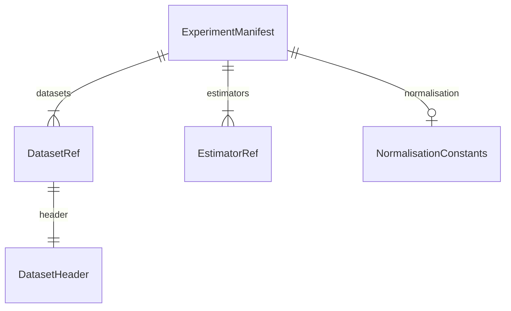

#### Attributes

| Name | Cardinality: | Type | Description |
| --- | --- | --- | --- |
| **[id](#experimentmanifest__id)** | <sub>1..1</sub> | string |  |
| **[command_lines](#experimentmanifest__command_lines)** | <sub>1..\*</sub> | string |  |
| **[created](#experimentmanifest__created)** | <sub>1..1</sub> | string | ISO 8601 timestamp. |
| **[datasets](#experimentmanifest__datasets)** | <sub>1..\*</sub> | [DatasetRef](#datasetref) |  |
| **[estimators](#experimentmanifest__estimators)** | <sub>1..\*</sub> | [EstimatorRef](#estimatorref) |  |
| **[generator_version](#experimentmanifest__generator_version)** | <sub>1..1</sub> | string |  |
| **[git_commit](#experimentmanifest__git_commit)** | <sub>1..1</sub> | string |  |
| **[normalisation](#experimentmanifest__normalisation)** | <sub>0..1</sub> | [NormalisationConstants](#normalisationconstants) |  |
| **[schema_version](#experimentmanifest__schema_version)** | <sub>1..1</sub> | string |  |


### FeatureLayout

Documents the model tensors (not stored as records). inputs [N, 240, 10]: bearing_sin, bearing_cos, own_x_km, own_y_km, own_course_sin, own_course_cos, own_speed_scaled, time_scaled, valid, window_mask. targets [N, 240, 6]: log_range_km, course_sin, course_cos, speed_scaled, x_km, y_km. loss_mask [N, 240]: window_mask and t ≥ zig_time.


#### Attributes

| Name | Cardinality: | Type | Description |
| --- | --- | --- | --- |
| **[input_channels](#featurelayout__input_channels)** | <sub>1..\*</sub> | string |  |
| **[rows](#featurelayout__rows)** | <sub>1..1</sub> | integer |  |
| **[target_channels](#featurelayout__target_channels)** | <sub>1..\*</sub> | string |  |


### FloatRange

Closed interval [min, max].

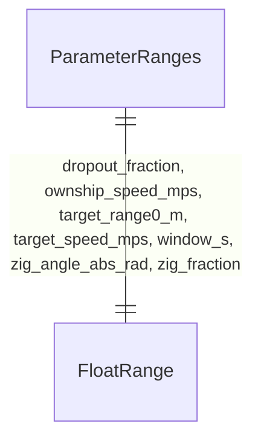

#### Attributes

| Name | Cardinality: | Type | Description |
| --- | --- | --- | --- |
| **[max](#floatrange__max)** | <sub>1..1</sub> | float |  |
| **[min](#floatrange__min)** | <sub>1..1</sub> | float |  |

#### Referenced by:

 *  **[ParameterRanges](#parameterranges)** : parameterRanges__dropout_fraction  <sub>1..1</sub> 
 *  **[ParameterRanges](#parameterranges)** : parameterRanges__ownship_speed_mps  <sub>1..1</sub> 
 *  **[ParameterRanges](#parameterranges)** : parameterRanges__target_range0_m  <sub>1..1</sub> 
 *  **[ParameterRanges](#parameterranges)** : parameterRanges__target_speed_mps  <sub>1..1</sub> 
 *  **[ParameterRanges](#parameterranges)** : parameterRanges__window_s  <sub>1..1</sub> 
 *  **[ParameterRanges](#parameterranges)** : parameterRanges__zig_angle_abs_rad  <sub>1..1</sub> 
 *  **[ParameterRanges](#parameterranges)** : parameterRanges__zig_fraction  <sub>1..1</sub> 


### GateCheck


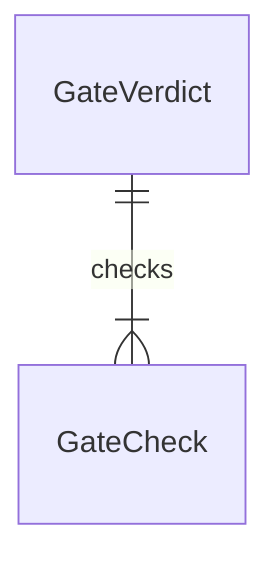

#### Attributes

| Name | Cardinality: | Type | Description |
| --- | --- | --- | --- |
| **[name](#gatecheck__name)** | <sub>1..1</sub> | string |  |
| **[detail](#gatecheck__detail)** | <sub>1..1</sub> | string |  |
| **[result](#gatecheck__result)** | <sub>1..1</sub> | [GateResult](#gateresult) |  |

#### Referenced by:

 *  **[GateVerdict](#gateverdict)** : gateVerdict__checks  <sub>1..\*</sub> 


### GateVerdict

Machine verdict for a gate; the team review records the final decision.


#### Attributes

| Name | Cardinality: | Type | Description |
| --- | --- | --- | --- |
| **[checks](#gateverdict__checks)** | <sub>1..\*</sub> | [GateCheck](#gatecheck) |  |
| **[decided_by](#gateverdict__decided_by)** | <sub>1..1</sub> | string |  |
| **[gate](#gateverdict__gate)** | <sub>1..1</sub> | [GateId](#gateid) |  |
| **[result](#gateverdict__result)** | <sub>1..1</sub> | [GateResult](#gateresult) |  |


### MetricsRecord

Metric values for one estimator on one slice at one evaluation point.


#### Attributes

| Name | Cardinality: | Type | Description |
| --- | --- | --- | --- |
| **[course_deg_median](#metricsrecord__course_deg_median)** | <sub>0..1</sub> | float |  |
| **[course_deg_p90](#metricsrecord__course_deg_p90)** | <sub>0..1</sub> | float |  |
| **[estimator](#metricsrecord__estimator)** | <sub>1..1</sub> | string |  |
| **[excluded](#metricsrecord__excluded)** | <sub>1..1</sub> | integer |  |
| **[gross_error_rate](#metricsrecord__gross_error_rate)** | <sub>0..1</sub> | float |  |
| **[n](#metricsrecord__n)** | <sub>1..1</sub> | integer |  |
| **[point](#metricsrecord__point)** | <sub>1..1</sub> | string | "final" or "zig+<n>s". |
| **[position_m_mean](#metricsrecord__position_m_mean)** | <sub>0..1</sub> | float |  |
| **[range_rel_median](#metricsrecord__range_rel_median)** | <sub>0..1</sub> | float |  |
| **[range_rel_p90](#metricsrecord__range_rel_p90)** | <sub>0..1</sub> | float |  |
| **[slice](#metricsrecord__slice)** | <sub>1..1</sub> | string | "overall" or e.g. "range_band=5-10km". |
| **[speed_kt_median](#metricsrecord__speed_kt_median)** | <sub>0..1</sub> | float |  |
| **[speed_kt_p90](#metricsrecord__speed_kt_p90)** | <sub>0..1</sub> | float |  |


### NaiveMeans

Training-set means used by the naive baseline for one prediction mode.

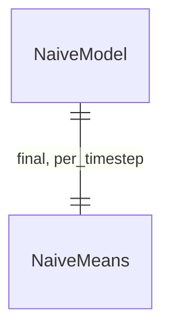

#### Attributes

| Name | Cardinality: | Type | Description |
| --- | --- | --- | --- |
| **[course_cos](#naivemeans__course_cos)** | <sub>1..1</sub> | float |  |
| **[course_sin](#naivemeans__course_sin)** | <sub>1..1</sub> | float |  |
| **[log_range_km](#naivemeans__log_range_km)** | <sub>1..1</sub> | float | Mean of ln(range in km). |
| **[n](#naivemeans__n)** | <sub>1..1</sub> | integer | Number of labels averaged. |
| **[speed_mps](#naivemeans__speed_mps)** | <sub>1..1</sub> | float |  |

#### Referenced by:

 *  **[NaiveModel](#naivemodel)** : naiveModel__final  <sub>1..1</sub> 
 *  **[NaiveModel](#naivemodel)** : naiveModel__per_timestep  <sub>1..1</sub> 


### NaiveModel

Naive baseline (SRD §5): predicts training-set means. final uses each scenario's last-sample label; per_timestep uses every post-zig label.


#### Attributes

| Name | Cardinality: | Type | Description |
| --- | --- | --- | --- |
| **[final](#naivemodel__final)** | <sub>1..1</sub> | [NaiveMeans](#naivemeans) |  |
| **[per_timestep](#naivemodel__per_timestep)** | <sub>1..1</sub> | [NaiveMeans](#naivemeans) |  |
| **[schema_version](#naivemodel__schema_version)** | <sub>1..1</sub> | string |  |
| **[train_digest](#naivemodel__train_digest)** | <sub>1..1</sub> | string | SHA-256 of the train file. |


### NormalisationConstants

Fixed scaling constants computed from the train split's input channels only.


#### Attributes

| Name | Cardinality: | Type | Description |
| --- | --- | --- | --- |
| **[computed_from](#normalisationconstants__computed_from)** | <sub>1..1</sub> | string | Always "inputs_only". |
| **[position_scale_km](#normalisationconstants__position_scale_km)** | <sub>1..1</sub> | float |  |
| **[speed_scale_mps](#normalisationconstants__speed_scale_mps)** | <sub>1..1</sub> | float |  |
| **[time_scale_s](#normalisationconstants__time_scale_s)** | <sub>1..1</sub> | float |  |
| **[train_header_digest](#normalisationconstants__train_header_digest)** | <sub>1..1</sub> | string | SHA-256 of the train header. |

#### Referenced by:

 *  **[ExperimentManifest](#experimentmanifest)** : experimentManifest__normalisation  <sub>0..1</sub> 


### Observation

One bearing from ownship to target. Stone Soup analogue Detection. When valid is false (dropout) bearing_rad is 0 and must be ignored.

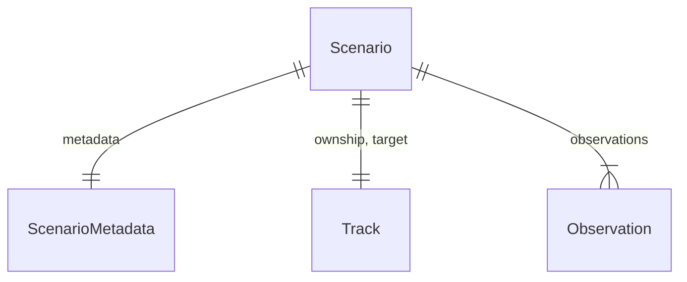

#### Attributes

| Name | Cardinality: | Type | Description |
| --- | --- | --- | --- |
| **[bearing_rad](#observation__bearing_rad)** | <sub>1..1</sub> | float |  |
| **[timestamp_s](#observation__timestamp_s)** | <sub>1..1</sub> | float |  |
| **[valid](#observation__valid)** | <sub>1..1</sub> | boolean |  |

#### Referenced by:

 *  **[Scenario](#scenario)** : scenario__observations  <sub>1..\*</sub> 


### ParameterRanges

Ranges from which ScenarioParameters are drawn. Initial ownship course, target bearing and target course are always uniform on [0, 2π); zig sign is uniform ±.

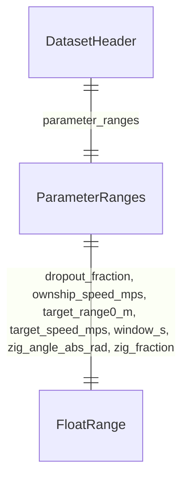

#### Attributes

| Name | Cardinality: | Type | Description |
| --- | --- | --- | --- |
| **[dropout_fraction](#parameterranges__dropout_fraction)** | <sub>1..1</sub> | [FloatRange](#floatrange) |  |
| **[dt_s](#parameterranges__dt_s)** | <sub>1..1</sub> | float |  |
| **[min_range_m](#parameterranges__min_range_m)** | <sub>1..1</sub> | float | Geometries closer than this at any sample are redrawn. |
| **[noise_sigma_rad_values](#parameterranges__noise_sigma_rad_values)** | <sub>1..\*</sub> | float | σ drawn uniformly from this set. |
| **[ownship_speed_mps](#parameterranges__ownship_speed_mps)** | <sub>1..1</sub> | [FloatRange](#floatrange) |  |
| **[range_distribution](#parameterranges__range_distribution)** | <sub>1..1</sub> | [RangeDistribution](#rangedistribution) |  |
| **[target_range0_m](#parameterranges__target_range0_m)** | <sub>1..1</sub> | [FloatRange](#floatrange) |  |
| **[target_speed_mps](#parameterranges__target_speed_mps)** | <sub>1..1</sub> | [FloatRange](#floatrange) |  |
| **[window_s](#parameterranges__window_s)** | <sub>1..1</sub> | [FloatRange](#floatrange) |  |
| **[zig_angle_abs_rad](#parameterranges__zig_angle_abs_rad)** | <sub>1..1</sub> | [FloatRange](#floatrange) |  |
| **[zig_fraction](#parameterranges__zig_fraction)** | <sub>1..1</sub> | [FloatRange](#floatrange) |  |

#### Referenced by:

 *  **[DatasetHeader](#datasetheader)** : datasetHeader__parameter_ranges  <sub>1..1</sub> 


### PlatformState

One platform state. Stone Soup analogue GroundTruthState.

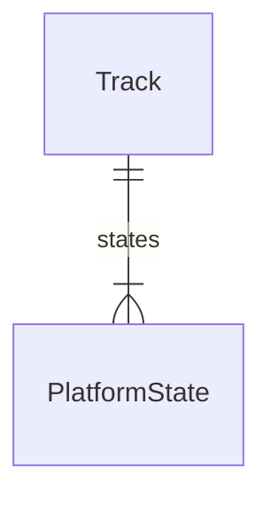

#### Attributes

| Name | Cardinality: | Type | Description |
| --- | --- | --- | --- |
| **[course_rad](#platformstate__course_rad)** | <sub>1..1</sub> | float |  |
| **[speed_mps](#platformstate__speed_mps)** | <sub>1..1</sub> | float |  |
| **[timestamp_s](#platformstate__timestamp_s)** | <sub>1..1</sub> | float |  |
| **[x_m](#platformstate__x_m)** | <sub>1..1</sub> | float |  |
| **[y_m](#platformstate__y_m)** | <sub>1..1</sub> | float |  |

#### Referenced by:

 *  **[Track](#track)** : track__states  <sub>1..\*</sub> 


### Prediction

One estimator's output for one scenario.

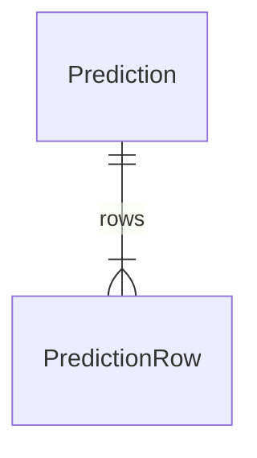

#### Attributes

| Name | Cardinality: | Type | Description |
| --- | --- | --- | --- |
| **[estimator](#prediction__estimator)** | <sub>1..1</sub> | string |  |
| **[mode](#prediction__mode)** | <sub>1..1</sub> | [PredictionMode](#predictionmode) |  |
| **[record](#prediction__record)** | <sub>1..1</sub> | [RecordKind](#recordkind) |  |
| **[rows](#prediction__rows)** | <sub>1..\*</sub> | [PredictionRow](#predictionrow) |  |
| **[scenario_index](#prediction__scenario_index)** | <sub>1..1</sub> | integer |  |


### PredictionHeader

First record of every prediction file.


#### Attributes

| Name | Cardinality: | Type | Description |
| --- | --- | --- | --- |
| **[dataset_digest](#predictionheader__dataset_digest)** | <sub>1..1</sub> | string | SHA-256 of the truth file. |
| **[estimator](#predictionheader__estimator)** | <sub>1..1</sub> | string |  |
| **[mode](#predictionheader__mode)** | <sub>1..1</sub> | [PredictionMode](#predictionmode) |  |
| **[record](#predictionheader__record)** | <sub>1..1</sub> | [RecordKind](#recordkind) |  |
| **[schema_version](#predictionheader__schema_version)** | <sub>1..1</sub> | string |  |


### PredictionRow

An estimator's target estimate at one timestep.


#### Attributes

| Name | Cardinality: | Type | Description |
| --- | --- | --- | --- |
| **[converged](#predictionrow__converged)** | <sub>1..1</sub> | boolean |  |
| **[course_rad](#predictionrow__course_rad)** | <sub>1..1</sub> | float |  |
| **[iterations](#predictionrow__iterations)** | <sub>0..1</sub> | integer |  |
| **[range_m](#predictionrow__range_m)** | <sub>1..1</sub> | float |  |
| **[speed_mps](#predictionrow__speed_mps)** | <sub>1..1</sub> | float |  |
| **[timestamp_s](#predictionrow__timestamp_s)** | <sub>1..1</sub> | float |  |
| **[x_m](#predictionrow__x_m)** | <sub>1..1</sub> | float |  |
| **[y_m](#predictionrow__y_m)** | <sub>1..1</sub> | float |  |

#### Referenced by:

 *  **[Prediction](#prediction)** : prediction__rows  <sub>1..\*</sub> 


### Scenario

One ownship-vs-target run over a window.

```mermaid
erDiagram
Observation {

}
Scenario {

}
ScenarioMetadata {

}
Track {

}

Scenario ||--|| ScenarioMetadata : "metadata"
Scenario ||--|| Track : "ownship, target"
Scenario ||--}| Observation : "observations"
ScenarioMetadata ||--|| ScenarioParameters : "parameters"
Track ||--}| PlatformState : "states"

```

#### Attributes

| Name | Cardinality: | Type | Description |
| --- | --- | --- | --- |
| **[metadata](#scenario__metadata)** | <sub>1..1</sub> | [ScenarioMetadata](#scenariometadata) |  |
| **[observations](#scenario__observations)** | <sub>1..\*</sub> | [Observation](#observation) |  |
| **[ownship](#scenario__ownship)** | <sub>1..1</sub> | [Track](#track) |  |
| **[record](#scenario__record)** | <sub>1..1</sub> | [RecordKind](#recordkind) |  |
| **[target](#scenario__target)** | <sub>1..1</sub> | [Track](#track) |  |


### ScenarioMetadata

Seed, parameter draws and derived slicing keys for one scenario.

```mermaid
erDiagram
Scenario {

}
ScenarioMetadata {

}
ScenarioParameters {

}

Scenario ||--|| ScenarioMetadata : "metadata"
Scenario ||--|| Track : "ownship, target"
Scenario ||--}| Observation : "observations"
ScenarioMetadata ||--|| ScenarioParameters : "parameters"

```

#### Attributes

| Name | Cardinality: | Type | Description |
| --- | --- | --- | --- |
| **[index](#scenariometadata__index)** | <sub>1..1</sub> | integer | Scenario index within the dataset. |
| **[mean_range_m](#scenariometadata__mean_range_m)** | <sub>1..1</sub> | float |  |
| **[min_range_m](#scenariometadata__min_range_m)** | <sub>1..1</sub> | float |  |
| **[parameters](#scenariometadata__parameters)** | <sub>1..1</sub> | [ScenarioParameters](#scenarioparameters) |  |
| **[samples](#scenariometadata__samples)** | <sub>1..1</sub> | integer | Number of timesteps (60–240). |
| **[seed](#scenariometadata__seed)** | <sub>1..1</sub> | string | Scenario seed as a decimal uint64 string. |
| **[zig_index](#scenariometadata__zig_index)** | <sub>1..1</sub> | integer | First timestep on leg 2. |
| **[zig_time_s](#scenariometadata__zig_time_s)** | <sub>1..1</sub> | float |  |

#### Referenced by:

 *  **[Scenario](#scenario)** : scenario__metadata  <sub>1..1</sub> 


### ScenarioParameters

The random draws that define one scenario.

```mermaid
erDiagram
ScenarioMetadata {

}
ScenarioParameters {

}

ScenarioMetadata ||--|| ScenarioParameters : "parameters"

```

#### Attributes

| Name | Cardinality: | Type | Description |
| --- | --- | --- | --- |
| **[dropout_fraction](#scenarioparameters__dropout_fraction)** | <sub>1..1</sub> | float | Probability each bearing is missing. |
| **[dt_s](#scenarioparameters__dt_s)** | <sub>1..1</sub> | float | Bearing interval. |
| **[noise_sigma_rad](#scenarioparameters__noise_sigma_rad)** | <sub>1..1</sub> | float | Bearing noise σ; 0 = noise-free. |
| **[ownship_course0_rad](#scenarioparameters__ownship_course0_rad)** | <sub>1..1</sub> | float | Ownship course on leg 1. |
| **[ownship_speed_mps](#scenarioparameters__ownship_speed_mps)** | <sub>1..1</sub> | float |  |
| **[target_bearing0_rad](#scenarioparameters__target_bearing0_rad)** | <sub>1..1</sub> | float | True bearing at window start. |
| **[target_course_rad](#scenarioparameters__target_course_rad)** | <sub>1..1</sub> | float |  |
| **[target_range0_m](#scenarioparameters__target_range0_m)** | <sub>1..1</sub> | float | Range at window start. |
| **[target_speed_mps](#scenarioparameters__target_speed_mps)** | <sub>1..1</sub> | float |  |
| **[window_s](#scenarioparameters__window_s)** | <sub>1..1</sub> | float | Window length; multiple of dt_s. |
| **[zig_angle_rad](#scenarioparameters__zig_angle_rad)** | <sub>1..1</sub> | float | Signed course change at the zig; positive is clockwise. |
| **[zig_fraction](#scenarioparameters__zig_fraction)** | <sub>1..1</sub> | float | Zig time as a fraction of the window. |

#### Referenced by:

 *  **[ScenarioMetadata](#scenariometadata)** : scenarioMetadata__parameters  <sub>1..1</sub> 


### Track

Time-ordered states of one platform. Stone Soup analogue GroundTruthPath.

```mermaid
erDiagram
PlatformState {

}
Scenario {

}
Track {

}

Scenario ||--|| ScenarioMetadata : "metadata"
Scenario ||--|| Track : "ownship, target"
Scenario ||--}| Observation : "observations"
Track ||--}| PlatformState : "states"

```

#### Attributes

| Name | Cardinality: | Type | Description |
| --- | --- | --- | --- |
| **[id](#track__id)** | <sub>1..1</sub> | [TrackId](#trackid) |  |
| **[states](#track__states)** | <sub>1..\*</sub> | [PlatformState](#platformstate) |  |

#### Referenced by:

 *  **[Scenario](#scenario)** : scenario__ownship  <sub>1..1</sub> 
 *  **[Scenario](#scenario)** : scenario__target  <sub>1..1</sub> 


## Slots

| Name | Cardinality/Range | Used By |
| --- | --- | --- |
| <a id="curvepoint__course_deg_median"></a>**curvePoint__course_deg_median** | <sub>1..1</sub><br/>float |  |
| <a id="curvepoint__estimator"></a>**curvePoint__estimator** | <sub>1..1</sub><br/>string |  |
| <a id="curvepoint__gross_error_rate"></a>**curvePoint__gross_error_rate** | <sub>1..1</sub><br/>float |  |
| <a id="curvepoint__n"></a>**curvePoint__n** | <sub>1..1</sub><br/>integer |  |
| <a id="curvepoint__range_rel_median"></a>**curvePoint__range_rel_median** | <sub>1..1</sub><br/>float |  |
| <a id="curvepoint__range_rel_p90"></a>**curvePoint__range_rel_p90** | <sub>1..1</sub><br/>float |  |
| <a id="curvepoint__speed_kt_median"></a>**curvePoint__speed_kt_median** | <sub>1..1</sub><br/>float |  |
| <a id="curvepoint__t_since_zig_s"></a>**curvePoint__t_since_zig_s** | <sub>1..1</sub><br/>float |  |
| <a id="datasetheader__created_by"></a>**datasetHeader__created_by**<br/>Command line that produced the file. | <sub>1..1</sub><br/>string |  |
| <a id="datasetheader__dataset_seed"></a>**datasetHeader__dataset_seed**<br/>Decimal uint64 string. | <sub>1..1</sub><br/>string |  |
| <a id="datasetheader__generator_version"></a>**datasetHeader__generator_version** | <sub>1..1</sub><br/>string |  |
| <a id="datasetheader__index_end"></a>**datasetHeader__index_end**<br/>Last scenario index (exclusive). | <sub>1..1</sub><br/>integer |  |
| <a id="datasetheader__index_start"></a>**datasetHeader__index_start**<br/>First scenario index (inclusive). | <sub>1..1</sub><br/>integer |  |
| <a id="datasetheader__parameter_ranges"></a>**datasetHeader__parameter_ranges** | <sub>1..1</sub><br/>[ParameterRanges](#parameterranges) |  |
| <a id="datasetheader__record"></a>**datasetHeader__record** | <sub>1..1</sub><br/>[RecordKind](#recordkind) |  |
| <a id="datasetheader__redraw_count"></a>**datasetHeader__redraw_count**<br/>Geometries rejected for violating min_range_m. | <sub>1..1</sub><br/>integer |  |
| <a id="datasetheader__scenario_count"></a>**datasetHeader__scenario_count** | <sub>1..1</sub><br/>integer |  |
| <a id="datasetheader__schema_version"></a>**datasetHeader__schema_version** | <sub>1..1</sub><br/>string |  |
| <a id="datasetheader__split"></a>**datasetHeader__split** | <sub>1..1</sub><br/>[Split](#split) |  |
| <a id="datasetref__header"></a>**datasetRef__header** | <sub>1..1</sub><br/>[DatasetHeader](#datasetheader) |  |
| <a id="datasetref__path"></a>**datasetRef__path** | <sub>1..1</sub><br/>string |  |
| <a id="estimatorref__name"></a>**estimatorRef__name** | <sub>1..1</sub><br/>string |  |
| <a id="estimatorref__settings_json"></a>**estimatorRef__settings_json**<br/>Estimator settings as JSON. | <sub>1..1</sub><br/>string |  |
| <a id="experimentmanifest__command_lines"></a>**experimentManifest__command_lines** | <sub>1..\*</sub><br/>string |  |
| <a id="experimentmanifest__created"></a>**experimentManifest__created**<br/>ISO 8601 timestamp. | <sub>1..1</sub><br/>string |  |
| <a id="experimentmanifest__datasets"></a>**experimentManifest__datasets** | <sub>1..\*</sub><br/>[DatasetRef](#datasetref) |  |
| <a id="experimentmanifest__estimators"></a>**experimentManifest__estimators** | <sub>1..\*</sub><br/>[EstimatorRef](#estimatorref) |  |
| <a id="experimentmanifest__generator_version"></a>**experimentManifest__generator_version** | <sub>1..1</sub><br/>string |  |
| <a id="experimentmanifest__git_commit"></a>**experimentManifest__git_commit** | <sub>1..1</sub><br/>string |  |
| <a id="experimentmanifest__id"></a>**experimentManifest__id** | <sub>1..1</sub><br/>string |  |
| <a id="experimentmanifest__normalisation"></a>**experimentManifest__normalisation** | <sub>0..1</sub><br/>[NormalisationConstants](#normalisationconstants) |  |
| <a id="experimentmanifest__schema_version"></a>**experimentManifest__schema_version** | <sub>1..1</sub><br/>string |  |
| <a id="featurelayout__input_channels"></a>**featureLayout__input_channels** | <sub>1..\*</sub><br/>string |  |
| <a id="featurelayout__rows"></a>**featureLayout__rows** | <sub>1..1</sub><br/>integer |  |
| <a id="featurelayout__target_channels"></a>**featureLayout__target_channels** | <sub>1..\*</sub><br/>string |  |
| <a id="floatrange__max"></a>**floatRange__max** | <sub>1..1</sub><br/>float |  |
| <a id="floatrange__min"></a>**floatRange__min** | <sub>1..1</sub><br/>float |  |
| <a id="gatecheck__detail"></a>**gateCheck__detail** | <sub>1..1</sub><br/>string |  |
| <a id="gatecheck__name"></a>**gateCheck__name** | <sub>1..1</sub><br/>string |  |
| <a id="gatecheck__result"></a>**gateCheck__result** | <sub>1..1</sub><br/>[GateResult](#gateresult) |  |
| <a id="gateverdict__checks"></a>**gateVerdict__checks** | <sub>1..\*</sub><br/>[GateCheck](#gatecheck) |  |
| <a id="gateverdict__decided_by"></a>**gateVerdict__decided_by** | <sub>1..1</sub><br/>string |  |
| <a id="gateverdict__gate"></a>**gateVerdict__gate** | <sub>1..1</sub><br/>[GateId](#gateid) |  |
| <a id="gateverdict__result"></a>**gateVerdict__result** | <sub>1..1</sub><br/>[GateResult](#gateresult) |  |
| <a id="metricsrecord__course_deg_median"></a>**metricsRecord__course_deg_median** | <sub>0..1</sub><br/>float |  |
| <a id="metricsrecord__course_deg_p90"></a>**metricsRecord__course_deg_p90** | <sub>0..1</sub><br/>float |  |
| <a id="metricsrecord__estimator"></a>**metricsRecord__estimator** | <sub>1..1</sub><br/>string |  |
| <a id="metricsrecord__excluded"></a>**metricsRecord__excluded** | <sub>1..1</sub><br/>integer |  |
| <a id="metricsrecord__gross_error_rate"></a>**metricsRecord__gross_error_rate** | <sub>0..1</sub><br/>float |  |
| <a id="metricsrecord__n"></a>**metricsRecord__n** | <sub>1..1</sub><br/>integer |  |
| <a id="metricsrecord__point"></a>**metricsRecord__point**<br/>"final" or "zig+<n>s". | <sub>1..1</sub><br/>string |  |
| <a id="metricsrecord__position_m_mean"></a>**metricsRecord__position_m_mean** | <sub>0..1</sub><br/>float |  |
| <a id="metricsrecord__range_rel_median"></a>**metricsRecord__range_rel_median** | <sub>0..1</sub><br/>float |  |
| <a id="metricsrecord__range_rel_p90"></a>**metricsRecord__range_rel_p90** | <sub>0..1</sub><br/>float |  |
| <a id="metricsrecord__slice"></a>**metricsRecord__slice**<br/>"overall" or e.g. "range_band=5-10km". | <sub>1..1</sub><br/>string |  |
| <a id="metricsrecord__speed_kt_median"></a>**metricsRecord__speed_kt_median** | <sub>0..1</sub><br/>float |  |
| <a id="metricsrecord__speed_kt_p90"></a>**metricsRecord__speed_kt_p90** | <sub>0..1</sub><br/>float |  |
| <a id="naivemeans__course_cos"></a>**naiveMeans__course_cos** | <sub>1..1</sub><br/>float |  |
| <a id="naivemeans__course_sin"></a>**naiveMeans__course_sin** | <sub>1..1</sub><br/>float |  |
| <a id="naivemeans__log_range_km"></a>**naiveMeans__log_range_km**<br/>Mean of ln(range in km). | <sub>1..1</sub><br/>float |  |
| <a id="naivemeans__n"></a>**naiveMeans__n**<br/>Number of labels averaged. | <sub>1..1</sub><br/>integer |  |
| <a id="naivemeans__speed_mps"></a>**naiveMeans__speed_mps** | <sub>1..1</sub><br/>float |  |
| <a id="naivemodel__final"></a>**naiveModel__final** | <sub>1..1</sub><br/>[NaiveMeans](#naivemeans) |  |
| <a id="naivemodel__per_timestep"></a>**naiveModel__per_timestep** | <sub>1..1</sub><br/>[NaiveMeans](#naivemeans) |  |
| <a id="naivemodel__schema_version"></a>**naiveModel__schema_version** | <sub>1..1</sub><br/>string |  |
| <a id="naivemodel__train_digest"></a>**naiveModel__train_digest**<br/>SHA-256 of the train file. | <sub>1..1</sub><br/>string |  |
| <a id="normalisationconstants__computed_from"></a>**normalisationConstants__computed_from**<br/>Always "inputs_only". | <sub>1..1</sub><br/>string |  |
| <a id="normalisationconstants__position_scale_km"></a>**normalisationConstants__position_scale_km** | <sub>1..1</sub><br/>float |  |
| <a id="normalisationconstants__speed_scale_mps"></a>**normalisationConstants__speed_scale_mps** | <sub>1..1</sub><br/>float |  |
| <a id="normalisationconstants__time_scale_s"></a>**normalisationConstants__time_scale_s** | <sub>1..1</sub><br/>float |  |
| <a id="normalisationconstants__train_header_digest"></a>**normalisationConstants__train_header_digest**<br/>SHA-256 of the train header. | <sub>1..1</sub><br/>string |  |
| <a id="observation__bearing_rad"></a>**observation__bearing_rad** | <sub>1..1</sub><br/>float |  |
| <a id="observation__timestamp_s"></a>**observation__timestamp_s** | <sub>1..1</sub><br/>float |  |
| <a id="observation__valid"></a>**observation__valid** | <sub>1..1</sub><br/>boolean |  |
| <a id="parameterranges__dropout_fraction"></a>**parameterRanges__dropout_fraction** | <sub>1..1</sub><br/>[FloatRange](#floatrange) |  |
| <a id="parameterranges__dt_s"></a>**parameterRanges__dt_s** | <sub>1..1</sub><br/>float |  |
| <a id="parameterranges__min_range_m"></a>**parameterRanges__min_range_m**<br/>Geometries closer than this at any sample are redrawn. | <sub>1..1</sub><br/>float |  |
| <a id="parameterranges__noise_sigma_rad_values"></a>**parameterRanges__noise_sigma_rad_values**<br/>σ drawn uniformly from this set. | <sub>1..\*</sub><br/>float |  |
| <a id="parameterranges__ownship_speed_mps"></a>**parameterRanges__ownship_speed_mps** | <sub>1..1</sub><br/>[FloatRange](#floatrange) |  |
| <a id="parameterranges__range_distribution"></a>**parameterRanges__range_distribution** | <sub>1..1</sub><br/>[RangeDistribution](#rangedistribution) |  |
| <a id="parameterranges__target_range0_m"></a>**parameterRanges__target_range0_m** | <sub>1..1</sub><br/>[FloatRange](#floatrange) |  |
| <a id="parameterranges__target_speed_mps"></a>**parameterRanges__target_speed_mps** | <sub>1..1</sub><br/>[FloatRange](#floatrange) |  |
| <a id="parameterranges__window_s"></a>**parameterRanges__window_s** | <sub>1..1</sub><br/>[FloatRange](#floatrange) |  |
| <a id="parameterranges__zig_angle_abs_rad"></a>**parameterRanges__zig_angle_abs_rad** | <sub>1..1</sub><br/>[FloatRange](#floatrange) |  |
| <a id="parameterranges__zig_fraction"></a>**parameterRanges__zig_fraction** | <sub>1..1</sub><br/>[FloatRange](#floatrange) |  |
| <a id="platformstate__course_rad"></a>**platformState__course_rad** | <sub>1..1</sub><br/>float |  |
| <a id="platformstate__speed_mps"></a>**platformState__speed_mps** | <sub>1..1</sub><br/>float |  |
| <a id="platformstate__timestamp_s"></a>**platformState__timestamp_s** | <sub>1..1</sub><br/>float |  |
| <a id="platformstate__x_m"></a>**platformState__x_m** | <sub>1..1</sub><br/>float |  |
| <a id="platformstate__y_m"></a>**platformState__y_m** | <sub>1..1</sub><br/>float |  |
| <a id="predictionheader__dataset_digest"></a>**predictionHeader__dataset_digest**<br/>SHA-256 of the truth file. | <sub>1..1</sub><br/>string |  |
| <a id="predictionheader__estimator"></a>**predictionHeader__estimator** | <sub>1..1</sub><br/>string |  |
| <a id="predictionheader__mode"></a>**predictionHeader__mode** | <sub>1..1</sub><br/>[PredictionMode](#predictionmode) |  |
| <a id="predictionheader__record"></a>**predictionHeader__record** | <sub>1..1</sub><br/>[RecordKind](#recordkind) |  |
| <a id="predictionheader__schema_version"></a>**predictionHeader__schema_version** | <sub>1..1</sub><br/>string |  |
| <a id="predictionrow__converged"></a>**predictionRow__converged** | <sub>1..1</sub><br/>boolean |  |
| <a id="predictionrow__course_rad"></a>**predictionRow__course_rad** | <sub>1..1</sub><br/>float |  |
| <a id="predictionrow__iterations"></a>**predictionRow__iterations** | <sub>0..1</sub><br/>integer |  |
| <a id="predictionrow__range_m"></a>**predictionRow__range_m** | <sub>1..1</sub><br/>float |  |
| <a id="predictionrow__speed_mps"></a>**predictionRow__speed_mps** | <sub>1..1</sub><br/>float |  |
| <a id="predictionrow__timestamp_s"></a>**predictionRow__timestamp_s** | <sub>1..1</sub><br/>float |  |
| <a id="predictionrow__x_m"></a>**predictionRow__x_m** | <sub>1..1</sub><br/>float |  |
| <a id="predictionrow__y_m"></a>**predictionRow__y_m** | <sub>1..1</sub><br/>float |  |
| <a id="prediction__estimator"></a>**prediction__estimator** | <sub>1..1</sub><br/>string |  |
| <a id="prediction__mode"></a>**prediction__mode** | <sub>1..1</sub><br/>[PredictionMode](#predictionmode) |  |
| <a id="prediction__record"></a>**prediction__record** | <sub>1..1</sub><br/>[RecordKind](#recordkind) |  |
| <a id="prediction__rows"></a>**prediction__rows** | <sub>1..\*</sub><br/>[PredictionRow](#predictionrow) |  |
| <a id="prediction__scenario_index"></a>**prediction__scenario_index** | <sub>1..1</sub><br/>integer |  |
| <a id="scenariometadata__index"></a>**scenarioMetadata__index**<br/>Scenario index within the dataset. | <sub>1..1</sub><br/>integer |  |
| <a id="scenariometadata__mean_range_m"></a>**scenarioMetadata__mean_range_m** | <sub>1..1</sub><br/>float |  |
| <a id="scenariometadata__min_range_m"></a>**scenarioMetadata__min_range_m** | <sub>1..1</sub><br/>float |  |
| <a id="scenariometadata__parameters"></a>**scenarioMetadata__parameters** | <sub>1..1</sub><br/>[ScenarioParameters](#scenarioparameters) |  |
| <a id="scenariometadata__samples"></a>**scenarioMetadata__samples**<br/>Number of timesteps (60–240). | <sub>1..1</sub><br/>integer |  |
| <a id="scenariometadata__seed"></a>**scenarioMetadata__seed**<br/>Scenario seed as a decimal uint64 string. | <sub>1..1</sub><br/>string |  |
| <a id="scenariometadata__zig_index"></a>**scenarioMetadata__zig_index**<br/>First timestep on leg 2. | <sub>1..1</sub><br/>integer |  |
| <a id="scenariometadata__zig_time_s"></a>**scenarioMetadata__zig_time_s** | <sub>1..1</sub><br/>float |  |
| <a id="scenarioparameters__dropout_fraction"></a>**scenarioParameters__dropout_fraction**<br/>Probability each bearing is missing. | <sub>1..1</sub><br/>float |  |
| <a id="scenarioparameters__dt_s"></a>**scenarioParameters__dt_s**<br/>Bearing interval. | <sub>1..1</sub><br/>float |  |
| <a id="scenarioparameters__noise_sigma_rad"></a>**scenarioParameters__noise_sigma_rad**<br/>Bearing noise σ; 0 = noise-free. | <sub>1..1</sub><br/>float |  |
| <a id="scenarioparameters__ownship_course0_rad"></a>**scenarioParameters__ownship_course0_rad**<br/>Ownship course on leg 1. | <sub>1..1</sub><br/>float |  |
| <a id="scenarioparameters__ownship_speed_mps"></a>**scenarioParameters__ownship_speed_mps** | <sub>1..1</sub><br/>float |  |
| <a id="scenarioparameters__target_bearing0_rad"></a>**scenarioParameters__target_bearing0_rad**<br/>True bearing at window start. | <sub>1..1</sub><br/>float |  |
| <a id="scenarioparameters__target_course_rad"></a>**scenarioParameters__target_course_rad** | <sub>1..1</sub><br/>float |  |
| <a id="scenarioparameters__target_range0_m"></a>**scenarioParameters__target_range0_m**<br/>Range at window start. | <sub>1..1</sub><br/>float |  |
| <a id="scenarioparameters__target_speed_mps"></a>**scenarioParameters__target_speed_mps** | <sub>1..1</sub><br/>float |  |
| <a id="scenarioparameters__window_s"></a>**scenarioParameters__window_s**<br/>Window length; multiple of dt_s. | <sub>1..1</sub><br/>float |  |
| <a id="scenarioparameters__zig_angle_rad"></a>**scenarioParameters__zig_angle_rad**<br/>Signed course change at the zig; positive is clockwise. | <sub>1..1</sub><br/>float |  |
| <a id="scenarioparameters__zig_fraction"></a>**scenarioParameters__zig_fraction**<br/>Zig time as a fraction of the window. | <sub>1..1</sub><br/>float |  |
| <a id="scenario__metadata"></a>**scenario__metadata** | <sub>1..1</sub><br/>[ScenarioMetadata](#scenariometadata) |  |
| <a id="scenario__observations"></a>**scenario__observations** | <sub>1..\*</sub><br/>[Observation](#observation) |  |
| <a id="scenario__ownship"></a>**scenario__ownship** | <sub>1..1</sub><br/>[Track](#track) |  |
| <a id="scenario__record"></a>**scenario__record** | <sub>1..1</sub><br/>[RecordKind](#recordkind) |  |
| <a id="scenario__target"></a>**scenario__target** | <sub>1..1</sub><br/>[Track](#track) |  |
| <a id="track__id"></a>**track__id** | <sub>1..1</sub><br/>[TrackId](#trackid) |  |
| <a id="track__states"></a>**track__states** | <sub>1..\*</sub><br/>[PlatformState](#platformstate) |  |

## Enums


### GateId


| Text | Meaning: | Description |
| --- | --- | --- |
| G0 | None | Pipeline verified. |
| G1 | None |  |
| G2 | None |  |
| G3 | None |  |

#### Used by

 *  **[GateVerdict](#gateverdict)** *[gateVerdict__gate](#gateverdict__gate)*  <sub>1..1</sub> 

### GateResult


| Text | Meaning: | Description |
| --- | --- | --- |
| fail | None |  |
| pass | None |  |

#### Used by

 *  **[GateCheck](#gatecheck)** *[gateCheck__result](#gatecheck__result)*  <sub>1..1</sub> 
 *  **[GateVerdict](#gateverdict)** *[gateVerdict__result](#gateverdict__result)*  <sub>1..1</sub> 

### PredictionMode


| Text | Meaning: | Description |
| --- | --- | --- |
| final | None | One row at the last timestep of the window. |
| per_timestep | None | One row per post-zig timestep using bearings up to that time. |

#### Used by

 *  **[PredictionHeader](#predictionheader)** *[predictionHeader__mode](#predictionheader__mode)*  <sub>1..1</sub> 
 *  **[Prediction](#prediction)** *[prediction__mode](#prediction__mode)*  <sub>1..1</sub> 

### RangeDistribution


| Text | Meaning: | Description |
| --- | --- | --- |
| log_uniform | None |  |
| uniform | None |  |

#### Used by

 *  **[ParameterRanges](#parameterranges)** *[parameterRanges__range_distribution](#parameterranges__range_distribution)*  <sub>1..1</sub> 

### RecordKind

Discriminator for records in NDJSON files.

| Text | Meaning: | Description |
| --- | --- | --- |
| header | None | Dataset or prediction file header (first line). |
| prediction | None | One Prediction. |
| scenario | None | One Scenario. |

#### Used by

 *  **[DatasetHeader](#datasetheader)** *[datasetHeader__record](#datasetheader__record)*  <sub>1..1</sub> 
 *  **[PredictionHeader](#predictionheader)** *[predictionHeader__record](#predictionheader__record)*  <sub>1..1</sub> 
 *  **[Prediction](#prediction)** *[prediction__record](#prediction__record)*  <sub>1..1</sub> 
 *  **[Scenario](#scenario)** *[scenario__record](#scenario__record)*  <sub>1..1</sub> 

### Split

Dataset split. Train/validation/test are 80/10/10 by scenario index.

| Text | Meaning: | Description |
| --- | --- | --- |
| heldout | None | Held-out geometry with parameter ranges outside training. |
| test | None |  |
| train | None |  |
| validation | None |  |

#### Used by

 *  **[DatasetHeader](#datasetheader)** *[datasetHeader__split](#datasetheader__split)*  <sub>1..1</sub> 

### TrackId


| Text | Meaning: | Description |
| --- | --- | --- |
| ownship | None |  |
| target | None |  |

#### Used by

 *  **[Track](#track)** *[track__id](#track__id)*  <sub>1..1</sub>

